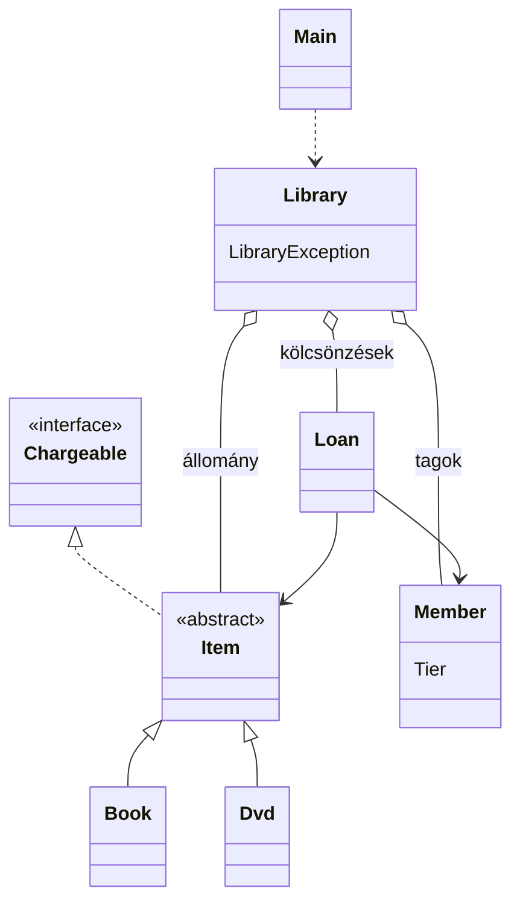

# 📚 Library – Java könyvtárkezelő konzolos alkalmazás

Kis méretű, objektumorientált Java projekt, amely egy könyvtár állományát, tagjait és kölcsönzéseit kezeli. A program konzolos menüvel vagy előre megírt demóforgatókönyvvel is futtatható. A projekt célja a Java nyelv fontosabb OOP-eszközeinek, a modern nyelvi elemeknek és a standard könyvtár használatának bemutatása.

---

## 📑 Tartalomjegyzék

1. [Funkciók](#1-funkciók)
2. [Felépítés](#3-felépítés)
3. [Tervezési döntések](#4-tervezési-döntések)
4. [Használt Java technológiák és nyelvi elemek](#5-használt-java-technológiák-és-nyelvi-elemek)
5. [Demó futás](#6-demó-futás)

---

## 1. Funkciók

- **Állomány kezelése:** könyvek és DVD-k felvétele, listázása, rendezése, keresése (kulcsszó alapján) és műfaj szerinti szűrése.
- **Tagkezelés:** tagok három szinttel (`STUDENT`, `STANDARD`, `PREMIUM`).
- **Kölcsönzés:** a rendszer a kölcsönzés előtt ellenőrzi, hogy
  - létezik-e a tag és a dokumentum,
  - elérhető-e a dokumentum,
  - nem érte-e el a tag a kölcsönzési limitet,
  - nincs-e a tagnak lejárt kölcsönzése,
  - a DVD korhatára megfelel-e a tag életkorának.
- **Visszavétel és késedelmi díj:** a kölcsönzési idő és a késedelmi díj a dokumentum típusától függ (könyvnél a műfajtól és az oldalszámtól is). A tagsági szint kedvezményt ad a díjra.
- **Lejárt kölcsönzések** listázása adott napra.
- **Fájlkezelés:** az állomány CSV-be menthető és onnan betölthető.
- **Statisztika és jelentés** készítése.

---

## 2. Felépítés

```text
src/library
├── Chargeable.java
├── Item.java
├── Book.java
├── Dvd.java
├── Member.java
├── Loan.java
├── Library.java
└── Main.java
```

| Fájl | Szerep | Fő koncepciók |
|---|---|---|
| `Chargeable` | interface | konstans, `default` és `static` metódus |
| `Item` | absztrakt ős | absztrakt metódusok, `Comparable`, `equals`/`hashCode`, template method, statikus factory (`fromCsv`), osztályszintű számláló |
| `Book` | `Item` leszármazott | öröklés, `@Override`, beágyazott `enum Genre` (mezők, konstruktor, metódus) |
| `Dvd` | `Item` leszármazott | polimorfizmus, validáció |
| `Member` | tag | egységbezárás, `unmodifiableList`, beágyazott `enum Tier` konstansonkénti metódustörzzsel |
| `Loan` | kölcsönzés | `LocalDate`, `ChronoUnit`, állapotkezelés, `IllegalStateException` |
| `Library` | központi osztály | `Map`/`List`, `Iterable`, saját checked kivétel (`LibraryException`), `Optional`, lambda, Stream API (`groupingBy`, `counting`), fájlkezelés try-with-resources-szel |
| `Main` | belépési pont | menü `Scanner`-rel, switch kifejezés, text block, demóforgatókönyv |

> A `Genre`, a `Tier` és a `LibraryException` a 8 fájlos keret miatt beágyazott típusként szerepel. Igény szerint külön fájlba emelhetők.

### Osztályhierarchia



> Az `Item` és a `Chargeable` kapcsolata a feladatleírás alapján feltételezett. Ha az `Item` nem implementálja közvetlenül, igazítsd a diagramot a kódhoz.

---

## 3. Tervezési döntések

- **Közös ős, specializált leszármazottak:** az `Item` absztrakt osztály fogja össze a közös adatokat és viselkedést, a `Book` és a `Dvd` a típusfüggő részeket (kölcsönzési idő, késedelmi díj) valósítja meg. A `Library` csak az `Item` típussal dolgozik, így új dokumentumtípus a meglévő kód módosítása nélkül adható hozzá.
- **Polimorfizmus a díjszámításban:** a késedelmi díj és a kölcsönzési idő típusonként más, a hívó oldal ezt nem ismeri.
- **Template method:** az `Item` a közös algoritmusvázat adja, a részleteket a leszármazottak töltik ki.
- **Egységbezárás:** a `Member` belső listáját nem adja ki módosíthatóan.
- **Hibakezelés:** a kölcsönzési szabályok megsértése saját checked kivétellel (`LibraryException`) jelzett, így a hívó kénytelen kezelni. A `Loan` érvénytelen állapotváltása `IllegalStateException`.
- **Validáció a konstruktorban:** hibás adattal nem jöhet létre objektum (pl. `Dvd`).
- **Tesztelhető idő:** a dátum paraméterként érkezik (`borrow`, `giveBack`, `overdueLoans`), nem a rendszeridőből, így a demó determinisztikus.
- **Perzisztencia egyszerűen:** CSV mentés és betöltés, a betöltést az `Item` statikus factory metódusa (`fromCsv`) végzi.

---

## 4. Használt Java technológiák és nyelvi elemek

**Objektumorientált tervezés**

- absztrakt osztályok és interface-ek, öröklés, polimorfizmus
- `default` és `static` interface metódusok, interface konstansok
- `equals`/`hashCode` és `Comparable` helyes megvalósítása
- template method minta, statikus factory metódus
- beágyazott enumok mezőkkel, konstruktorral és konstansonkénti metódustörzzsel

**Modern Java (nyelvi újdonságok)**

- switch kifejezések (nyíl szintaxis)
- text blockok (`"""`) és `String.formatted`
- lambda kifejezések és metódushivatkozások
- Stream API (`groupingBy`, `counting`, szűrés, rendezés)
- `Optional` a hiányzó értékek kezelésére

**Standard könyvtár**

- `java.time`: `LocalDate`, `ChronoUnit` (dátumszámítás, késedelmi napok)
- Collections: `Map`, `List`, `Comparator`, `unmodifiableList`
- `Iterable` megvalósítása (a könyvtár `for-each`-ben bejárható)
- `java.nio.file`: `Files`, `Path`, try-with-resources a CSV I/O-hoz
- `Scanner` a konzolos felülethez

**Hibakezelés**

- saját checked kivétel, `IllegalStateException`, többágú `catch`
- try-with-resources az erőforrások biztonságos lezárásához

---

## 5. Demó futás

A projekt elindítása után 8 inputra adott konzolkimenete: 

```text
--- 1. Stock (Natural order: by title) ---
[DVD] D003   A dzsungel könyve                  (1967) available
[BOOK] B002   A Pál utcai fiúk                   (1906) available
[BOOK] B003   Algoritmusok és adatszerkezetek    (2009) available
[BOOK] B004   Az idő rövid története             (1988) available
[BOOK] B005   Effective Java                     (2018) available
[BOOK] B001   Egri csillagok                     (1901) available
[DVD] D001   Interstellar                       (2014) available
[DVD] D002   Ponyvaregény                       (1994) available

--- 2. Polimorphism: descriptions ---
Book: Gárdonyi Géza - Egri csillagok, 1901. (Fiction, 520 page, 28 days untill return)
Book: Molnár Ferenc - A Pál utcai fiúk, 1906. (Childresn book, 240 page, 35 days untill return)
Book: Thomas H. Cormen - Algoritmusok és adatszerkezetek, 2009. (Textbook, 1292 page, 14 days untill return)
Book: Stephen Hawking - Az idő rövid története, 1988. (Scientific paper, 256 page, 35 days untill return)
Book: Joshua Bloch - Effective Java, 2018. (Textbook, 416 page, 14 days untill return)
DVD: Interstellar, 2014. (169 minutes, pegi 12, 7 days untill return)
DVD: Ponyvaregény, 1994. (154 minutes, pegi 18, 7 days untill return)
DVD: A dzsungel könyve, 1967. (78 minutes, pegi 0, 7 days untill return)

--- 3. Successful loans ---
OK:   Algoritmusok és adatszerkezetek ? Kiss Anna | loandate: 2025-03-01, returndate: 2025-03-15
OK:   A Pál utcai fiúk ? Nagy Béla | loandate: 2025-03-01, returndate: 2025-04-05
OK:   Interstellar ? Tóth Cecília | loandate: 2025-03-01, returndate: 2025-03-08

--- 4. Unsuccessful loans (exception handling) ---
ERROR: Nagy Béla is not of ?Ponyvaregény? age limit (18+).
ERROR: ?Algoritmusok és adatszerkezetek? is currently loaned.
ERROR: No such member: M09
OK:   Egri csillagok ? Nagy Béla | loandate: 2025-03-01, returndate: 2025-03-29
OK:   Az idő rövid története ? Nagy Béla | loandate: 2025-03-01, returndate: 2025-04-05
ERROR: Nagy Béla Loan limit reached (3).

--- 5. Overdue loans 2025-03-20 ---
Interstellar ? Tóth Cecília | loandate: 2025-03-01, returndate: 2025-03-08 | late by: 12 day(s)
Algoritmusok és adatszerkezetek ? Kiss Anna | loandate: 2025-03-01, returndate: 2025-03-15 | late by: 5 day(s)

--- 6. Return date and late fee ---
OK:   B003 returned (2025-03-25), late fee: 22 Usd
OK:   D001 returned (2025-03-10), late fee: 15 Usd
OK:   B002 returned (2025-03-15), late fee: 0 Usd
ERROR: The B002 id document is not loaned.

--- 7. Search and filter ---
Search ?java?: [[BOOK] B005   Effective Java                     (2018) available]
Search ?géza?: [[BOOK] B001   Egri csillagok                     (1901) loaned]
Textbooks: 
  [BOOK] B003   Algoritmusok és adatszerkezetek    (2009) available
  [BOOK] B005   Effective Java                     (2018) available

--- 8. Save and load from file ---
Loaded: 8 (all inistances of Items: 24)

--- 9. Report ---
=== City Library ? stock (2025-03-26) ===
Stock: 8{BOOK=5, DVD=3}
Members: 3 member
Active loans: 2 Overdue loans: 0 Late fee: 37 Usd
Most popular: A Pál utcai fiúk
```
